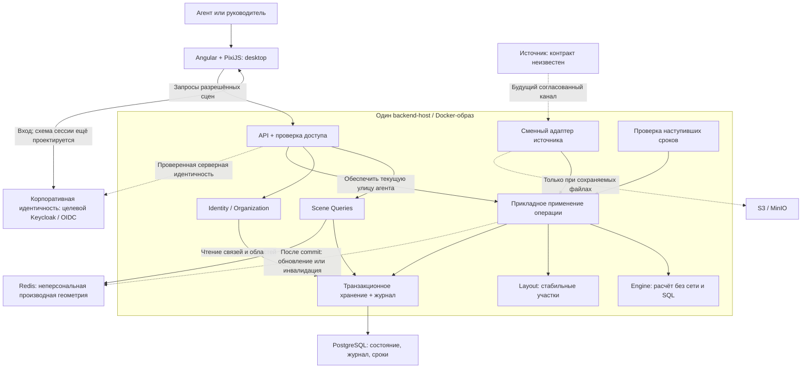

# Целевая архитектура VSK City

Статус: проект технического решения для корпоративного MVP, не реализованная система.
Корпоративные ограничения и игровые правила уже приняты; предложенные здесь способы
разбиения, блокировок и кеширования требуют согласования до соответствующей реализации.
Внешний контракт сознательно отложен и не придумывается ради завершения диаграммы.

## 1. Основания и основной выбор

Источники: [MVP-SCOPE](../MVP-SCOPE.md), [SRS-ENGINE](../SRS/SRS-ENGINE.md),
[SRS-STORAGE](../SRS/SRS-STORAGE.md), [GAME-RULES](../GAME-RULES.md),
[CR-01–CR-05](CORPORATE-REQUIREMENTS.md), [концепция v0.4](../concept/Insurance_City_Concept_Architecture_v0.4.md).
SRS определяют требуемое поведение; этот документ предлагает способ его реализации.

Для недорогой первой версии — модульный монолит на ASP.NET Core/C#: одна backend-кодовая
база, один образ приложения и общая транзакционная PostgreSQL-БД. API и фоновый обработчик
сноса первоначально работают в одном backend-host. Логический модуль не равен микросервису.
При измеренной необходимости worker можно выделить отдельно, сохранив прикладной путь применения.
См. [ADR-001](ADR-001-modular-backend.md), статус «Предложено».

Angular/TypeScript управляет оболочкой и навигацией; PixiJS отображает сцены. В браузере
нет самостоятельного зачёта продаж, расчёта XP или решения о раскрытии чужих имён.
Redis восстанавливается; PostgreSQL хранит бизнес-истину. S3/MinIO появляется только
при сценарии постоянного файлового хранения, не ради самих статических спрайтов.

## 2. Контекст и развёртываемые части

Frontend и backend поставляются независимо. PostgreSQL, Redis и корпоративный провайдер
идентичности — внешние зависимости, не дополнительные процессы в образе backend.
Точные домены, ingress/TLS, realm, сессии, env-ключи и число реплик задаются контрактом окружения.
Диаграмма не утверждает, что источник уже предоставляет Kafka, HTTP, файл или нужные поля.
Kafka остаётся целевым транспортом концепции; конкретный коннектор нельзя реализовать по догадке.

## 3. Модули и направления зависимостей

| Модуль | Ответственность | Чего не делает |
| --- | --- | --- |
| Identity / Organization | Разрешает учётную запись в доверенный внутренний контекст, области прав, текущую/исторические улицы | Не доверяет role/agentId из query браузера и не переносит старый вклад по текущему справочнику |
| Source Adapter | Проверяет будущий согласованный формат, разрешает внешние данные во внутренние операции | Не внедряет поля источника в Engine и не вызывает его мимо прикладного сервиса |
| Application | Координирует зачёт, повторы, транзакцию, версию и эффекты | Не хранит единственную копию мира в singleton или процессе |
| Engine | Вычисляет XP, парковки, статусы и эффекты с заданными временем/правилами | Не вызывает PostgreSQL, Redis, Kafka, часы ОС или API источника |
| Layout | Выделяет/переиспользует участки и сохраняет их положение | Не перестраивает существующие улицы от количества текущих продаж |
| Persistence | Атомарно сохраняет состояние, зачёт, квитанции, сроки и историю | Не заменяет ошибки БД seed и не делает Redis носителем истины |
| Scene Queries / API | Читает согласованные версии и формирует разрешённые представления нужной детализации | Не возвращает журнал договоров, полный оргсправочник или скрытые имена |
| Demolition Worker | Находит наступившие сроки и вызывает общее применение завершения сноса | Не хранит срок только в памяти и не изменяет XP отдельным обходным SQL-путём |

Зависимости ядра направлены внутрь: прикладной слой использует Engine и порты хранения;
конкретные PostgreSQL/Redis/источник находятся в инфраструктуре. Engine не зависит от формата
HTTP, Kafka-сообщения, CSV или таблицы конкретной страховой системы.
Порты — обычные внутрипроцессные интерфейсы, не повод создавать дополнительные сетевые сервисы.
Физические .NET-проекты и каталоги определяются при декомпозиции, текущий E01 не реорганизуется этим документом.

Новые улицы и изменения оргпривязки, влияющие на игровой мир, также проходят через
Application и общие транзакционные гарантии. Порты чтения Identity/Queries не дают
обходного пути записи XP, участков или зачётов.

Layout участвует в том же кандидате изменения и commit, что Engine: участок не становится
занятым отдельно от создания дома, а перенос парковочного вклада не фиксируется наполовину.

## 4. Путь изменения состояния

1. Адаптер разрешает допустимую внутреннюю операцию и её связь с вкладом/улицей.
   Если связи нет, возвращает диагностируемую зависимость, не угадывает договор.
2. Application открывает транзакцию PostgreSQL и проверяет идентичность применения
   вместе с текущим состоянием зачёта. Новый request ID не обходит семантическую защиту.
3. Под транзакционной защитой загружается свежая версия затронутой улицы; ранее прочитанная
   вне защиты копия не используется как актуальная для записи.
4. Engine и Layout вычисляют кандидат. Прикладной слой проверяет инварианты.
5. Состояние, участки, квитанция, журнал, deadline и версия фиксируются одним commit.
6. Только после commit результат признаётся применённым; Redis обновляется/инвалидируется
   как производная копия. Потерянный ответ или сбой кеша не создают второго зачёта.

Предлагаемый базовый механизм — блокировка строки корня улицы в PostgreSQL на время её
операции, а не единственная блокировка всего мира. Уникальность применения и допустимого
перехода вклада дополнительно защищается в БД. Для нескольких улиц блокировки берутся
в стабильном порядке; общий порядок захвата связей зачёта/организации и улиц нужно
детализировать до кода, чтобы все пути соблюдали один протокол. Повторы после конфликтов
ограничены и не включают повторное выполнение уже закоммиченного бизнес-эффекта.

Это предложение гранулярности, не готовый DDL или доказанная нагрузочная модель.
Порядок игровых операций, спорные случаи ожидающих домов и исправления остаются вопросами
SRS-ENGINE/будущего адаптера; row-lock сам по себе их не определяет.

## 5. Снос и работа нескольких экземпляров

Срок хранится в PostgreSQL вместе с жизненным циклом дома. Worker периодически выбирает
кандидатов с наступившим deadline и передаёт завершение сноса в Application.
После получения защиты улицы статус и срок проверяются повторно: другой worker мог уже
выполнить задание. Удаление текущего объекта, освобождение участка, перераспределение
фактически оставшегося XP и квитанция завершения входят в одну транзакцию.

Все реплики могут обнаружить один deadline, но доменный эффект допускается один.
При падении до commit задачу можно повторить; после commit повтор не перераспределяет XP.
После простоя срок не назначается заново. GET не является единственным способом выполнения сноса.
Постоянная очередь в Redis или обязательный брокер фоновых задач для этой механики не требуются.

Начальное совместное размещение API/worker уменьшает число сервисов, но связывает их
ресурсные бюджеты и обновление. Выделение worker — основание для пересмотра ADR-001,
а не изменение правил сохранения. Интервал polling и допустимое опоздание согласуются отдельно.

## 6. Хранение и производные представления

### PostgreSQL

Логические наборы — улицы, участки/занятость, дома, парковки, зачёт договоров, применения/
эффекты, оргсвязи и версии. Физическая схема/индексы ещё не утверждены; целевая система
не обязана хранить весь мир в единственной JSONB-строке E01.
Журнал сохраняет исходную улицу и порядок применений: текущие итоги не восстанавливают
исторически накопленное распределение. Полный event sourcing не является обязательным.

Миграции выполняются отдельным управляемым шагом поставки с резервной копией и проверкой
на восстановленном окружении. Startup корпоративного приложения не должен автоматически
создавать демонстрационный мир или очищать данные. Перенос E01 в реальный портфель — отдельное решение.

### Redis и приватность кеша

Базовый безопасный вариант — кешировать общую геометрию без имён и оргсправочника.
Персональные подписи и выделение своей улицы добавляются после серверной проверки прав.
Готовые ответы агента и руководителя не складываются под один общий ключ улицы.

Производный кеш привязан к версии доменного состояния и версии правил проекции;
проверка актуальности опирается на PostgreSQL, не только на TTL или удачу инвалидации.
Конкретный протокол чтения версии/повторного чтения при гонке должен быть описан в API/data-design.
При потере кеша данные восстанавливаются из PG; нельзя терять квитанции или сроки вместе с Redis.

### Версии и чтение

Версия состояния, rulesVersion и версия схемы БД различаются. Один снимок улицы не смешивает
части до и после операции. Обзор города может объединять несколько улиц: его политика
свежести/версий требует отдельного контракта, глобальный атомарный снимок страны не обещается
без специального механизма. Одинаковая объявленная версия сцены должна обозначать
один и тот же набор её объектов: нельзя выдавать разные смеси частей под одним ID версии.
Составная версия или сохранённая проекция выбирается до реализации read API.
Персонализация не меняет общие объекты одной версии.

## 7. Сцены и клиентский поток

Корпоративный read API предоставляет профиль/стартовую сцену, страну, город, улицу
и проверку актуальности. Имена endpoint из концепции остаются эскизом до API-контракта.
Страна не загружает все дома компании; город и улица получают детализацию по сцене/видимости.
Пагинация/LOD/границы выборок определяются по измеренным объёмам, не искусственным лимитом домов.

Клиент показывает актуальный снимок, периодически проверяет версии и загружает обновлённое
представление без проигрывания пропущенных действий. WebSocket, журнал анимаций и сложный
клиентский changes API не обязательны. Старый ответ не должен заменять более свежую сцену;
изменение rulesVersion не должно оставлять старую проекцию при прежней версии состояния.

Агент попадает на текущую улицу даже без продаж. Создание пустой улицы выполняется сервером
идемпотентно после разрешения агента/города — при подготовке справочника либо первом входе,
не из случайного клиентского ID. Наблюдателю игровая улица не создаётся.
Корпоративная аутентификация, области доступа и правила исторических улиц остаются обязательной
отдельной детализацией; демо-переключатель роли не является её заменой.

PNG/manifest версионируются по содержимому. Точки опоры и слой по положению на земле
не зависят от XP-карточек или порядка загрузки текстур. Смена рисунка не двигает участок.
Служебные каталоги/исходники художника, используемые в E01 для проверки, не объявляются
обязательными публичными production-маршрутами. Поставка runtime-ассетов проектируется отдельно.

## 8. Поставка, ошибки и наблюдаемость

- Образ backend настраивается через env; секреты не попадают в репозиторий, образ или логи.
- БД/кеш/провайдер идентичности не заменяются локальным seed при недоступности.
- PostgreSQL недоступен — изменения не подтверждаются. Redis недоступен — используется
  согласованный режим деградации с PG; это не утрата прогресса.
- Диагностика различает применение, идентичный повтор, конфликт, неразрешённую зависимость
  и технический сбой; журнал доступен только разрешённым служебным потребителям.
- Нужны отдельные сигналы жизнеспособности процесса и готовности обслуживать операции;
  точные health/readiness-контракты ещё проектируются, один зелёный HTTP не доказывает работу worker.
- Наблюдаемы ошибки/время применения, задержка сноса, конфликты, недоступность зависимостей
  и состояние миграций. Численные пороги, алерты, RPO/RTO и сроки хранения не придуманы.
- При сохраняемых файлах используется S3/MinIO с метаданными в PG; общая транзакция
  PG+S3/Kafka не предполагается. Если потребуется надёжная публикация наружу, её гарантии
  и механизм, например transactional outbox, выбираются отдельным решением по реальному сценарию.

## 9. Отношение к существующему E01

| Уже есть в питче | Не считается готовым корпоративным решением |
| --- | --- |
| Angular/Pixi, карта, сцены, спрайты и навигация | Приёмка по реальным объёмам, целевой read API, устранение перекрытия центра |
| Engine и синтетические unit-сценарии | Полная модель зачёта реальных договоров, исправлений, переводов и порядка |
| PostgreSQL JSONB под row-lock, Redis version-cache | Целевая схема, гранулярность улицы, индексы и миграции |
| Фоновый DemolitionWorker | Проверенная работа корпоративных реплик, нагрузка и эксплуатационная готовность |
| Demo role / agentId и API demo actions | Настоящая идентичность, серверная авторизация и интеграционный интерфейс |

При реализации новое приложение/схема не должны молча подменять используемый localhost-мир.
Требуются отдельные окружение/БД и контролируемое переключение. Наличие схемы на бумаге
не закрывает E01, корпоративный этап C или какой-либо будущий Feature/Story.

## 10. Решения и дальнейшая детализация

| Область | Базовое предложение | Что ещё проверить/согласовать |
| --- | --- | --- |
| Развёртывание | Модульный backend, API и worker в одном host | ADR-001, бюджеты, условия выделения worker |
| Транзакции | Корень улицы + ограничения БД, единый путь применения | DDL, общий протокол блокировок, конкуренция/повторы |
| Кеш | Неперсональная геометрия; раскрытие имён после проверки | Версии, гонки, деградация и ограничения памяти |
| Чтение | Снимки нужной сцены, не весь мир каждым GET | DTO, свежесть городских агрегатов, объёмы/LOD |
| Интеграция | Сменный адаптер перед внутренними операциями | Позже: реальный контракт/маппинг/порядок; сейчас не требуется его выдумывать |
| Идентичность | Корпоративный OIDC/Keycloak из концепции | Сессии, claims, привязка агента и исторические области прав |

Трассировка: Engine/Layout покрывают FR-ENG-01…11; единое применение и Persistence —
FR-STO-01…07/09/10; версии/Scene Queries/кеш — FR-STO-08. Это архитектурное соответствие,
не отметка реализации или прохождения будущих тестов.

Следующие независимые документы: проект физической схемы и протокола транзакций,
внутренние интерфейсы модулей и read API. Затем — атомарные Features/Stories.
Источник остаётся отложенной интеграционной зависимостью, не запретом проектировать ядро.
