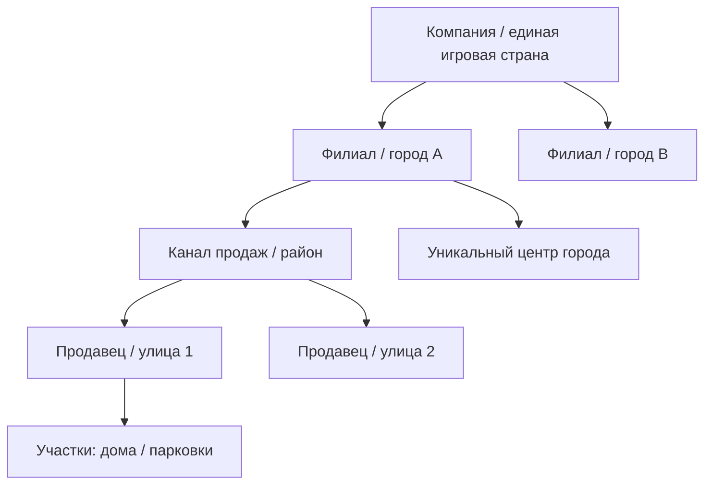
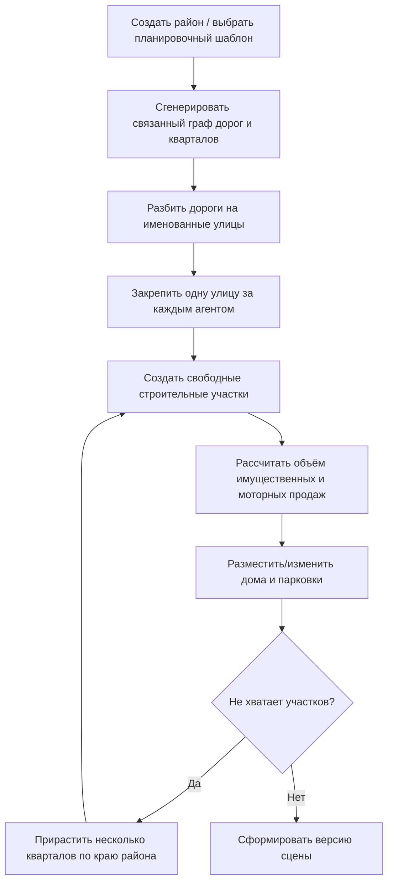
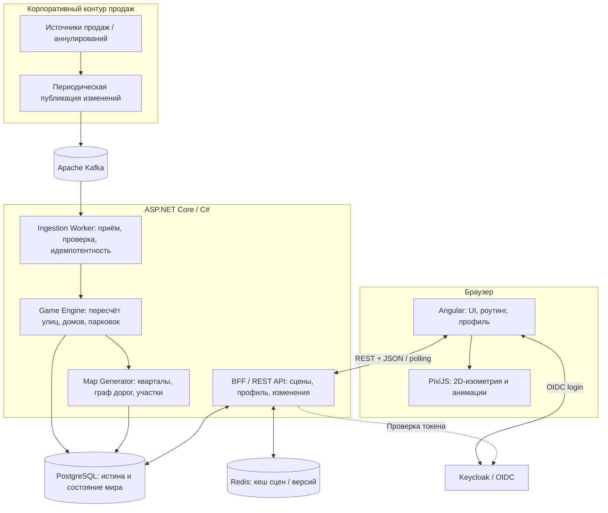
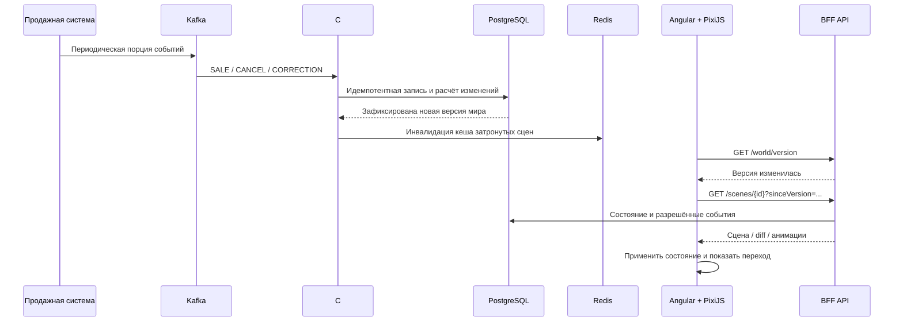

# Insurance City
## Продуктовая концепция, игровые механики и целевая архитектура

> **Версия:** 0.3 — рабочий концепт для обсуждения с бизнесом, архитекторами, разработкой и художником  
> **Статус:** концепция; не является согласованным техническим заданием  
> **Целевой формат:** корпоративное web-приложение, часть контура продаж страховой компании  
> **Технологии:** Angular + TypeScript + PixiJS; ASP.NET Core / C#; PostgreSQL; Kafka; Redis; Keycloak

---

## 1. Краткое резюме

**Insurance City** — браузерная игровая визуализация реальных продаж страховых продуктов. Каждый продавец развивает собственную улицу, канал продаж — район, филиал — город, а вся компания — единую виртуальную страну.

Игровой мир **не подменяет существующую аналитику продаж**. KPI, премии, планы и отчётность живут в обычных корпоративных интерфейсах. Игра показывает результат в эмоциональной, наглядной форме: строятся дома, растёт этажность, появляются парковки, развиваются кварталы и узнаваемые городские центры.

**Основные договорённости:**

1. **Имущественные продажи определяют количество домов** на улице агента.
2. **Моторные продажи определяют размер/уровень развития домов.**
3. **Если есть моторные продажи, но нет имущественных, появляется открытая парковка.**
4. **Аннулирование** визуализируется как изменение мира: табличка «Под снос», демонтаж дома или реконструкция/уменьшение здания в зависимости от категории договора.
5. **Мир един для всех**: любая роль может исследовать игровую страну и видеть всю застройку.
6. Агент при входе оказывается **на своей улице** и в любой момент может нажать **«Моя улица»**.
7. Чужие улицы для агента по умолчанию **не подписаны именами владельцев**; исключение может составлять публичное признание лидеров.
8. Руководители **не имеют персональной кнопки «Моя улица»**, но могут получать расширенную информацию о продавцах согласно полномочиям.
9. У каждого города есть **уникальный центральный объект (landmark)**: например, Волгоград — «Родина-мать зовёт!».
10. Планировка — **компактные связанные кварталы**, а не набор длинных параллельных улиц («сосисок»).
11. Данные поступают **периодически**; не требуется непрерывная онлайн-симуляция или специальный серверный игровой движок.

---

## 2. Цели и границы

### 2.1. Цели

- Сделать личный вклад в продажи визуально ощутимым.
- Дать агенту возможность сравнить свою улицу с соседними районами и другими городами без раскрытия персональных сведений коллег.
- Создать единую картину всей компании для сотрудников и руководства.
- Добавить мотивационные механики признания лидеров, не превращая игру в дополнительную отчётность.
- Обеспечить технически простой запуск во внутреннем web-контуре компании.

### 2.2. Что не является целью MVP

- Не строим самостоятельный BI / систему KPI.
- Не разрабатываем полноценный экономический симулятор с ресурсами, жителями, налогами и бюджетом города.
- Не даём пользователям вручную прокладывать дороги, строить или переставлять дома.
- Не используем Unity, Unreal Engine или полноценное серверное 3D.
- Не требуем WebSocket, непрерывной 60 FPS симуляции или постоянной связи клиента с Kafka.
- Не делаем бесшовную 3D-камеру от масштаба страны до отдельного окна здания.

---

## 3. Модель игрового мира



| Уровень | Бизнес-сущность | Игровая сущность | Смысл |
|---|---|---|---|
| Страна | Компания | Общий мир | Обзор всех филиалов |
| Город | Филиал | Город | Коллективный результат филиала |
| Район | Канал продаж филиала | Район | Результат команды/канала |
| Улица | Агент/продавец | Улица | Персональный вклад |
| Участок/здание | Результат продаж | Дом, парковка, стройплощадка | Материализация продаж |
| Центр города | Идентичность филиала | Landmark и площадь | Узнаваемость, навигация, гордость |

**Принцип:** объекты мира существуют независимо от конкретного пользователя и устройства. Одна и та же улица должна иметь один и тот же облик для агента, его руководителя и руководства компании; меняется только информационный слой и доступность подписей.

---

## 4. Игровые правила

### 4.1. Имущественное страхование — количество домов

- Зачтённая продажа имущественного полиса увеличивает застройку улицы.
- В **исходной модели для проверки механики**: 1 зачтённый имущественный полис = 1 дом.
- Дом размещается на участке, закреплённом за улицей продавца.
- Если участок ещё не застроен, проигрывается краткая анимация строительства.
- Для больших объёмов нужно проверить масштабируемость правила «1 полис = 1 дом»: при необходимости ввести управляемые пороги/агрегацию без изменения бизнес-смысла.

### 4.2. Моторное страхование — размер зданий

- Моторные продажи увеличивают уровень / высоту / визуальный размер уже построенных домов.
- Моторные баллы распределяются между домами **детерминированно**, чтобы застройка не «прыгала» при каждом обновлении.
- Возможные уровни здания для первой графической библиотеки: 1) малоэтажный дом; 2) таунхаус или увеличенный дом; 3) среднеэтажное здание; 4) многоэтажка; 5) высотка.
- **Точная формула распределения моторных продаж, предел высотности и связь с премией или количеством договоров пока не согласованы.** Не зашиваем коэффициенты в графический движок.

### 4.3. Моторные продажи без имущества

Если у агента есть моторные продажи, но нет имущественных, его улица **не остаётся пустой**:

- появляется открытая парковка;
- число машин/мест или оформление парковки может расти вместе с моторными продажами;
- после первой имущественной продажи появляется дом, а накопленный моторный результат учитывается при определении уровня застройки;
- правила дальнейшего сосуществования парковки и домов подлежат уточнению; парковка не должна «исчезать» из-за технического сбоя пересчёта.

### 4.4. Аннулирования и корректировки

| Событие | Изменение расчётного состояния | Возможная анимация |
|---|---|---|
| Продажа имущества | + дом/строительный участок | Строительные леса, появление дома |
| Продажа мотора | + уровень/размер или расширение парковки | Реконструкция, рост здания |
| Аннулирование имущества | − дом, перераспределение уровней при необходимости | Табличка «Под снос», затем демонтаж |
| Аннулирование мотора | − моторные баллы | Реконструкция и уменьшение уровня, сокращение парковки |
| Исправление/откат операции | Пересчёт до достоверного состояния | Отмена незавершённой анимации или новое изменение |

**Техническое правило:** бизнес-событие и анимация — разные сущности. База хранит корректное конечное состояние, а интерфейс показывает переход к нему. При входе после длительного отсутствия можно сразу отобразить актуальную сцену, не воспроизводя сотни старых сносов и строек.

**Осторожно с привязкой:** в MVP отдельный дом не обязан быть юридически связан с конкретным полисом. При аннулировании движок может детерминированно выбирать объект для удаления, если итоговое количество домов остаётся правильным.

### 4.5. Баланс между продажами

- Объём застройки и высотность отражают **две разные продуктовые категории**, поэтому внешне большие улицы не обязательно означают лучший общий KPI.
- Соревнование основано на визуальном сравнении и признании достижений, а не на приписывании единой «оценки эффективности» форме улицы.
- Обычные отчётные метрики, планы и финансовые показатели остаются в основном продажном контуре.

---

## 5. Генерация города: не «сосиски», а живая квартальная сеть

### 5.1. Базовый принцип

**Сначала создаётся связанная городская планировка, затем дороги и строительные участки распределяются между улицами продавцов.**

Город состоит из нескольких районов. Район — из кварталов, которые соединены дорожным графом. Каждая улица агента — это **один связный маршрут из нескольких дорожных сегментов**, который может проходить через разные кварталы и пересекаться с другими улицами.



### 5.2. Район из десяти агентов

Пример: в агентском канале работают 10 продавцов. Генератор:

1. Создаёт несколько смежных кварталов и центральный/вспомогательные проезды.
2. Формирует в дорожной сети **не менее 10 именованных связанных улиц**.
3. Назначает каждой улице `street_id` и одного действующего владельца (`seller_id`) с сохранением в PostgreSQL.
4. Формирует вдоль улиц строительные участки и однозначно закрепляет каждый участок за **одной** улицей (даже около перекрёстков).
5. Размещает на этих участках дома или парковки согласно продажам.
6. При росте продаж уплотняет/достраивает кварталы и только затем расширяет территорию района.

**Что запрещено алгоритму:** переставлять существующие дома при каждой загрузке, менять владельцев улиц после обычного пересчёта, генерировать пересекающиеся здания, создавать бесконечные линейные дороги без кварталов.

### 5.3. Расширение города

- Существующие объекты и их координаты сохраняются.
- Рост происходит по предсказуемым правилам: сначала доступные участки, затем соседний квартал, затем расширение района.
- Новые кварталы должны стыковаться с графом дорог и соблюдать заранее определённые точки подключения.
- При изменении состава агентов новые улицы добавляются в дорожный граф; реорганизации и перевод продавцов — отдельный сценарий миграции.
- Для разнообразия можно иметь несколько планировочных шаблонов: сетка кварталов, центральная площадь, бульварная структура, район с парком.

### 5.4. Детерминированность

У города и района есть сохранённые `layout_seed`, версия генератора и постоянные ID улиц/участков. Декоративные вариации могут определяться seed, но бизнес-значимое размещение фиксируется в БД.

**Не пересоздаём весь город из текущих суммарных продаж при каждом импорте.** Обновляем только изменившиеся улицы/участки и при необходимости расширяем планировку. Это защищает идентичность улиц и прогресс агента.

---

## 6. Уникальный центр каждого города (landmark)

Каждый филиал-город получает **постоянный узнаваемый центральный объект**, расположенный на городской площади или в другом композиционном центре.

**Пример:** Волгоград — стилизованная скульптура «Родина-мать зовёт!». Другие возможные ориентиры: Казань — Кул-Шариф, Санкт-Петербург — Петропавловский собор, Владивосток — Золотой мост, Новосибирск — оперный театр.

Правила:

- Landmark существует **независимо от продаж**: агентам не нужно «строить» исторический символ с нуля.
- Центр — точка узнавания и навигационный якорь города; на уровне страны может использоваться его силуэт/значок.
- При коллективном развитии филиала может улучшаться **окружение**: освещение, парк, фонтан, площадь, аллеи. Это декоративная механика, а не KPI-дашборд.
- Landmark — отдельный тип ассета и сущность сцены, не принадлежащая агенту или каналу.
- Для художника необходимо зафиксировать единый стиль, визуальный масштаб и перечень городов.

> Использование узнаваемых памятников в графике требует отдельной проверки прав на конкретные изображения/модели и согласования визуального образа; лучше создавать собственные стилизованные иллюстрации, а не копировать чужие ассеты.

---

## 7. Видимость, роли, авторизация и мотивация

### 7.1. Основное правило доступа

**Всем пользователям доступен для исследования весь визуальный игровой мир** — страна, города, районы, улицы и застройка. **Персональные данные и служебные детали** скрываются либо раскрываются согласно полномочиям.

Это позволяет агенту видеть, что соседние улицы красивее и масштабнее, сравнивать себя с лидерами и возвращаться к собственному результату.

### 7.2. Аутентификация и сопоставление ролей

- Авторизация и вход — **Keycloak (OIDC)**.
- Angular получает пользовательскую сессию и обращается к BFF с access token.
- BFF проверяет токен и сопоставляет идентификатор пользователя с корпоративным справочником работников, `seller_id`, `branch_id`, `channel_id` и управленческой ролью.
- **Keycloak отвечает за идентичность и роли**, BFF — за бизнес-привязку, права раскрытия информации и персонализацию карты.
- Сокрытие имён должно обеспечиваться **на уровне API**, а не только отключением подписей в браузере.

### 7.3. Поведение по ролям

| Сценарий | Агент | Руководитель канала | Директор филиала | Центральное руководство |
|---|---|---|---|---|
| Обзор всей игровой страны | Да | Да | Да | Да |
| Просмотр чужих улиц и домов | Да | Да | Да | Да |
| Стартовая сцена | Своя улица | Свой район | Свой город | Страна |
| Кнопка «Моя улица» | Да, постоянно | Нет | Нет | Нет |
| Имя владельца собственной улицы | Да | Не применимо | Не применимо | Не применимо |
| Имена чужих владельцев | По умолчанию нет | В пределах полномочий | В пределах филиала | По полномочиям |
| Публичные улицы-лидеры | По отдельным правилам признания | По отдельным правилам | По отдельным правилам | По отдельным правилам |

*Границы управленческих полномочий — проектное предположение, подлежащее согласованию с корпоративной ролевой моделью.*

**Нерешённый сценарий:** руководитель может одновременно иметь `seller_id` и собственную улицу. Нужен явный приоритет роли/режима либо возможность переключения, а не молчаливое предположение.

### 7.4. Навигация агента

1. Вход через Keycloak.
2. BFF возвращает профиль и `homeStreetId`.
3. Angular открывает сцену собственной улицы и выделяет её название.
4. Агент свободно исследует другие улицы, районы, города и страну.
5. При нажатии **«Моя улица»** приложение возвращает камеру/сцену к `homeStreetId`.
6. Чужие улицы выглядят полноценно, но без раскрытия имён продавцов (кроме разрешённых публичных достижений).

### 7.5. Известность и публичное признание

Для сильных агентов можно добавить «известные улицы»:

- собственная улица всегда подписана и выделена у её владельца;
- наиболее развитые/отмеченные улицы могут иметь **публичное название** и декоративную арку, памятный знак, площадь или другой landmark локального масштаба;
- на уровне города выделяются признанные лидеры филиала, на уровне страны — редкие общекорпоративные достижения;
- общий рейтинг по абсолютному объёму не должен автоматически лишать небольшие филиалы шанса на признание: возможны категории «рост», «выполнение плана» и др.;
- **правила публичного показа фамилий, наград и истории достижений нужно согласовать отдельно** с HR/ИБ/юристами и владельцем данных.

---

## 8. Сцены, масштабирование и UI

| Масштаб | Что отображается | Детализация |
|---|---|---|
| **Страна** | Карта страны, филиалы-города, городские силуэты/символы | Агрегированные представления, без индивидуальных домов |
| **Город** | Центр-landmark, районы, дороги, общий силуэт застройки | Средняя детализация |
| **Район** | Связанная дорожная сеть, кварталы, улицы, основные объекты | Высокая детализация |
| **Улица** | Дома, этажность, парковки, таблички «Под снос», стройка | Максимальная детализация |

**Навигационная модель MVP:** связанные **отдельные сцены** со сменой уровня детализации и визуально плавными переходами, а не единая бесконечная 3D-поверхность. Это сохраняет ощущение целого мира, но существенно упрощает web-разработку.

UI содержит:

- карту PixiJS;
- навигационные цепочки «страна → город → район → улица»;
- поиск города/района (при необходимости);
- кнопку **«Моя улица»** только для роли агента;
- обозначение собственных объектов и разрешённых известных улиц;
- небольшие уведомления о строительстве/сносе и изменении мира;
- обычную корпоративную панель навигации.

**KPI на игровую карту не дублируем.** При необходимости можно предусмотреть переход в стандартные разделы аналитики, но этот переход не является частью игрового рендера.

Для производительности:

- на уровне страны не загружаем тысячи отдельных домов;
- детализацию сцены запрашиваем по уровню и области видимости;
- графику загружаем из локального набора спрайтов;
- анимации запускаем по событиям, статические сцены не требуют постоянной симуляции;
- сцены и наборы ассетов можно кешировать.

---

## 9. Целевая техническая архитектура



### 9.1. Backend / BFF

**ASP.NET Core / C#** как единая кодовая база с логическими модулями:

- **Ingestion Worker** — читает Kafka, проверяет формат, обрабатывает повторы и порядок событий.
- **Game Engine** — пересчитывает продажи в дома/уровни/парковки и создаёт игровые события.
- **Map Generator** — поддерживает связность кварталов и стабильное размещение улиц и участков.
- **REST API / BFF** — отдаёт сцены, версии, профиль пользователя, персональные подсветки и допустимые подписи.

В MVP их можно развёртывать как одно приложение/решение. При росте нагрузки Worker и API можно масштабировать независимо, сохраняя общие контракты.

### 9.2. PostgreSQL

Источник истины для:

- организационной структуры (`branch`, `channel`, `seller`);
- игрового мира (`city`, `district`, `street`, `road_segment`, `block`, `lot`, `building`, `landmark`);
- привязки улиц к продавцам и сохранённых координат/seed;
- учтённых продаж, агрегированных игровых результатов;
- журнала операций, версий мира, событий анимации и служебных метаданных импорта.

### 9.3. Kafka

События из систем продаж публикуются **периодически**, но обрабатываются как изменения. Kafka используется как существующая корпоративная транспортная инфраструктура, а не как способ подключения браузера к игровому миру.

Требуются:

- `event_id`/ключ идемпотентности;
- версия/время бизнес-события и ключ договора;
- понятный контракт `SALE`, `CANCEL`, `CORRECTION`;
- обработка задержанных и неупорядоченных событий;
- возможность сверки и полного пересчёта из достоверных данных.

**Важно:** если источник присылает лишь итоговые агрегаты за период, невозможно надёжно воспроизвести все промежуточные продажи и аннулирования, которые взаимно компенсировались. Для полноценной анимации нужен журнал событий или достаточно подробная история изменений.

### 9.4. Redis

Необязателен для корректности, но полезен для:

- кеширования агрегированных сцен страны/города/района;
- кеширования последней версии мира;
- ускорения часто повторяющихся запросов.

**Никогда не используем Redis как единственный источник состояния мира.** При его потере клиент получает сцены из PostgreSQL, а кеш восстановится.

### 9.5. Angular + PixiJS

- **Angular** — корпоративная оболочка, Keycloak/OIDC, маршрутизация, навигация, управление состоянием интерфейса.
- **PixiJS** — отображение изометрических спрайтов, камеры, масштабирования, слоёв сцены и коротких анимаций.
- **Браузер** не рассчитывает продажи и не определяет права раскрытия персональных данных.
- **GPU на сервере не нужен**; рисование выполняется клиентом. Рабочие места должны поддерживать целевой режим отрисовки (предпочтительно WebGL); совместимость с корпоративными браузерами проверяется в прототипе.

---

## 10. Поток данных и согласованность



**Соглашения:**

1. Результат одного пакета публикуется как согласованная версия мира после успешной фиксации расчётов.
2. Повторная доставка события не должна создавать второй дом или повторно уменьшать этажность.
3. В рамках изменившейся улицы пересчитываются её объекты, районные/городские агрегаты и связанные представления, а не весь мир.
4. При пропуске нескольких версий клиент получает **актуальный снимок**, а не обязан проигрывать весь исторический журнал.
5. Обработка ошибок, некорректных пакетов и сверка источников должны быть наблюдаемы.

---

## 11. Пример API-контрактов (эскиз)

> Ниже — предварительные контракты для согласования между Angular и C#. Названия методов и состав полей могут измениться.

| Метод | Назначение |
|---|---|
| `GET /api/me` | Роль, область полномочий, `homeStreetId`, доступные действия |
| `GET /api/world/version` | Текущая опубликованная версия игрового мира |
| `GET /api/world/country` | Обобщённая карта страны и силуэты городов |
| `GET /api/cities/{cityId}/scene` | Город, центр-landmark и районы |
| `GET /api/districts/{districtId}/scene` | Дороги, кварталы и доступные улицы района |
| `GET /api/streets/{streetId}/scene` | Участки, дома, парковки, состояния объектов |
| `GET /api/scenes/{sceneId}/changes?sinceVersion=N` | Изменения и анимационные события |

Пример профиля агента:

```json
{
  "userId": "user-501",
  "role": "AGENT",
  "homeStreetId": "street-142",
  "startScene": { "type": "STREET", "id": "street-142" },
  "capabilities": {
    "exploreWholeWorld": true,
    "showMyStreetButton": true,
    "revealOtherSellerNames": false
  }
}
```

Пример объекта сцены:

```json
{
  "worldVersion": 105,
  "sceneId": "street-142",
  "street": {
    "id": "street-142",
    "displayName": "Моя улица",
    "isMine": true
  },
  "objects": [
    {
      "id": "building-007",
      "type": "HOUSE",
      "level": 3,
      "lotId": "lot-064",
      "x": 640,
      "y": 352,
      "assetKey": "house_level3_variant2"
    }
  ],
  "events": [
    {
      "eventId": "game-9844",
      "type": "MARK_FOR_DEMOLITION",
      "objectId": "building-007"
    }
  ]
}
```

Отдельное требование: **BFF не должен отдавать агенту имена владельцев чужих улиц в скрытых полях JSON**. Разрешённые публичные подписи формируются на сервере.

---

## 12. Система графических ресурсов и задача художника

Нужен **2D Game Artist**, создающий *модульный набор изометрических ассетов*, а не целую статичную картинку города.

### 12.1. Что можно заказать заранее

| Пакет | Состав | Ориентировочный объём |
|---|---|---|
| Style Guide | Палитра, перспектива, масштаб, тени, сетка, тестовая сцена | 1 набор |
| Здания | 5 уровней развития × 2–3 визуальных варианта | 10–15 спрайтов |
| Парковки | Открытая, расширенная, частично заполненная и т. п. | 3–5 спрайтов |
| Дороги и кварталы | Прямые сегменты, повороты, T/X-перекрёстки, тротуары, газоны, участки | 10–15+ модулей |
| События | Стройка, леса, кран, табличка «Под снос», демонтаж | Отдельные слои/кадры |
| Декор и признание | Деревья, фонари, скверы, арки известных улиц | 10–15 элементов |
| Landmarks | Уникальный символ каждого города, базовый центр и улучшенное окружение | По количеству филиалов |

**Форматы:** PNG/WebP с прозрачностью для runtime, исходники в редактируемом формате, sprite sheets для анимаций, каталог ассетов и описание размеров/точек привязки/занимаемых клеток.

### 12.2. Что художник должен согласовать с frontend заранее

- Единый изометрический ракурс и размеры логической клетки (например, тестовый ориентир **128×64 px**, не финальный стандарт).
- Размеры оснований зданий и их «следы» на участках.
- Слои (земля, дороги, здания, эффекты, подписи), порядок перекрытия объектов.
- Якорные точки (`anchor`), прозрачные поля, требования к теням.
- Принцип замены здания одного уровня другим без смещения фундамента.
- Модульность дорог и места стыковки кварталов.

**Рекомендуемый первый результат:** одна связная тестовая мини-сцена района: несколько пересекающихся улиц, 5 зданий разных уровней, парковка, landmark-заглушка, табличка «Под снос» и одна анимация строительства.

### 12.3. Зависимость от разработки

Художник может начать работу **до готовности BFF**. Важно сначала утвердить стилистику и провести короткий технический тест импорта 5–10 реальных ассетов в PixiJS, прежде чем запускать весь пакет в производство.

---

## 13. Оценка сложности и этапность

**Предварительная экспертная оценка сложности:** средняя для корпоративной web-разработки; повышенная для процедурной графики и согласованного роста городской структуры. Это не смета и не обязательство по срокам.

| Результат | Ориентировочный срок при выделенной команде | Содержание |
|---|---|---|
| Визуальный прототип | 3–5 недель | 2 вымышленных города, кварталы, улицы, дома, парковка, простые анимации; фиктивные данные |
| MVP на реальных данных | 10–16 недель суммарно от старта | Angular/PixiJS, C# BFF, Keycloak, Kafka, PostgreSQL, базовая ролевая модель и обновления |
| Расширение до промышленного масштаба | Ориентир 4–6 месяцев суммарно | Большой объём объектов, оптимизация, наблюдаемость, приёмочные испытания, развитие каталога ассетов |

Ориентир трудозатрат прежней архитектуры — **153–270 чел.-дн.**; после решения о квартальном генераторе необходимо добавить приблизительно **10–20 чел.-дн.** на топологию, распределение участков и тестирование расширения. Поэтому текущий диапазон для планирования **примерно 160–290 чел.-дн.** с существенной неопределённостью графики, интеграций и объёмов данных.

**Предполагаемая команда:** 1 Angular-разработчик, 1 frontend-разработчик с опытом 2D/Canvas/PixiJS, 1 C#-разработчик, 2D-художник около 0,5 FTE, QA около 0,5 FTE на соответствующих этапах, DevOps/архитектор/аналитик частично.

### 13.1. Очерёдность

**Этап A — технический и визуальный proof of concept**

- Одна квартальная сцена, которая выглядит как город, а не как набор рядов.
- 10 вымышленных агентов и автоматическое распределение их улиц.
- Строительство дома, рост дома от мотора, открытая парковка без имущества, снос.
- Локальные данные без интеграции.
- Проверка производительности на типовом офисном компьютере.

**Этап B — продуктовый прототип**

- Два вымышленных города, разные планировки и уникальные центральные объекты.
- Страна → город → район → улица.
- Персональный режим агента с кнопкой «Моя улица».
- Сравнение с чужой застройкой без чужих имён.

**Этап C — корпоративный MVP**

- Keycloak и соответствие ролей.
- Kafka и периодические обновления продаж.
- C# Engine, PostgreSQL, согласованные снимки мира, история изменений.
- Redis-кеш при необходимости, проверки прав, аудит интеграций.
- Пилот на ограниченном числе филиалов.

**Этап D — масштабирование и признание лидеров**

- Полный охват филиальной сети.
- Landmarks всех городов.
- Публичные известные улицы и правила наград (после согласования).
- Оптимизация LOD и расширенные визуальные события.

---

## 14. Критерии приёмки MVP (черновик)

1. Агент после входа через Keycloak видит собственную улицу и может вернуться на неё кнопкой с любого доступного уровня карты.
2. Агент способен просматривать другие города и улицы, **не получая из API закрытые персональные данные их владельцев**.
3. Руководитель видит всю игровую территорию, а разрешённые подписи/данные — в соответствии с ролью.
4. При имущественной продаже появляется дом; при моторной — меняется размер дома либо парковка; при отсутствии имущества и наличии мотора показана открытая парковка.
5. При аннулировании корректно меняется состояние улицы и доступна соответствующая анимация сноса/реконструкции.
6. Район из 10 агентов имеет **связанную квартальную структуру** с пересекающимися улицами и общими магистралями; это не 10 изолированных линейных коридоров.
7. Новые продажи не перемещают существующие улицы и дома произвольно.
8. Повторный приём одного и того же события не дублирует игровой объект.
9. Одна и та же опубликованная версия мира одинаково отображается у разных пользователей с учётом разрешённых подписей.
10. У каждого города есть уникальный landmark, выделяемый в центре и представляемый в обзоре страны.
11. На масштабе страны браузер не обязан загружать детальные спрайты всех зданий.
12. При недоступности Redis мир восстанавливается из PostgreSQL без потери игрового прогресса.

---

## 15. Открытые вопросы для следующей проработки

| Вопрос | Почему важен | Предварительная позиция |
|---|---|---|
| Что считается продажей? Оформление, оплата, вступление в силу? | Влияет на появление/снос объектов | Выбрать единый зачётный статус |
| 1 полис = 1 дом при тысячах договоров? | Масштаб сцен и эстетика | Проверить на данных, предусмотреть коэффициенты |
| Как мотор распределяется по домам? | Предсказуемый рост и уровни | Детерминированное распределение, формулу согласовать |
| Как обрабатывается мотор при переходе из парковки к домам? | Устойчивость логики развития | Сохранять накопленный результат |
| Источник передаёт события или снимки? | Доступность полноценной истории изменений | Предпочтительны событийные дельты |
| Каков интервал загрузки? | Частота обновления и анимаций | Настраиваемый; 15 минут — только пример |
| Как обрабатываются переводы агент→канал/филиал? | Сохранение истории улицы | Нужна отдельная миграционная политика |
| Может ли руководитель быть одновременно агентом? | Стартовая сцена и кнопка «Моя улица» | Нужен приоритет/переключатель |
| Нужно ли раскрывать имена лидеров всей компании? | Мотивация против требований приватности | Только по согласованной политике |
| Какая карта страны: географическая или стилизованная? | Влияет на UX верхнего уровня | Определить на прототипе |
| Сколько филиалов, каналов, продавцов, продаж в день? | LOD, объём сцены, PostgreSQL и Kafka | Собрать реальные оценки до проектирования нагрузки |
| Что означает «уровень благоустройства центра»? | Контент художника и правила прогресса | Декоративное развитие по общей активности |
| Нужен ли исторический просмотр мира за прошлую дату? | Хранение снимков и UX | В MVP необязателен |

---

## 16. Принципы, которые считаем зафиксированными

> **1.** Это **одна общая игровая страна**, а не набор индивидуальных игр.  
> **2.** Агент видит весь мир, но **его собственная улица персонально выделена**.  
> **3.** Имущество создаёт **количество домов**, мотор определяет **размер**, мотор без имущества даёт **открытую парковку**.  
> **4.** Аннулирования становятся **событиями изменения игрового мира**.  
> **5.** Районы состоят из **настоящих связанных кварталов**, а не параллельных бесконечных улиц.  
> **6.** У каждого города — **свой узнаваемый центральный landmark**.  
> **7.** Аналитика продаж остаётся **отдельной от геймификации**.  
> **8.** Технологический стек: **Angular + PixiJS + C# + PostgreSQL + Kafka + Redis + Keycloak**.  
> **9.** Backend формирует и хранит **достоверное состояние мира**, браузер **отрисовывает и анимирует**.  
> **10.** Первая цель — **живой, убедительный квартал и два демонстрационных города**, затем подключение реальных продаж.

