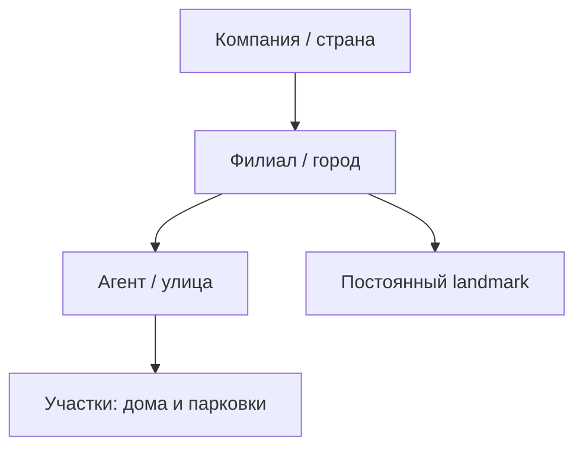
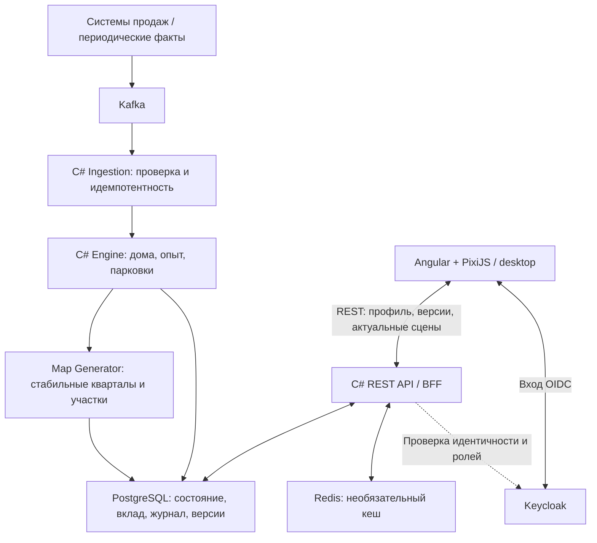

# Insurance City
## Продуктовая концепция и целевая архитектура v0.4

Версия: 0.4 — актуализация по результатам последовательного обсуждения открытых вопросов.
Дополнение: первая версия без игровых районов; улицы принадлежат городам напрямую.
Статус: принятые продуктовые решения и целевая архитектура; не полное согласованное ТЗ.
Формат: корпоративное web-приложение для desktop-браузера.
Целевой стек: Angular + TypeScript + PixiJS; ASP.NET Core / C#; PostgreSQL; Kafka; Keycloak.
Redis — необязательный кеш, не источник истины.

Канонический источник игровых формул и исключений: [принятые игровые правила](../GAME-RULES.md).
Исходная [версия 0.3](Insurance_City_Concept_Architecture_v0.3.md) сохранена без изменений
для истории; её отменённые предложения не являются действующими требованиями.

## 1. Резюме и изменения относительно v0.3

Insurance City — общая игровая визуализация результатов страховых продаж.
Агент развивает улицу внутри города; филиал представлен городом, компания — страной.
Каналы сохраняются в оргструктуре для прав доступа, но не образуют игровые территории.
Игра не заменяет аналитику продаж и не отображает премии, планы или KPI.

| Область | Решение v0.4 |
| --- | --- |
| Вход | Факты заключения и досрочной терминации; премия неизвестна |
| Имущество | Ровно один дом за один зачтённый договор, без агрегации |
| Мотор | Один договор = один опыт; 8 визуальных уровней до 100 этажей |
| Опыт | Новые моторы развивают наименее прокачанные дома; новая имущественная продажа не уменьшает старые |
| Избыток | Видимые парковки, не скрытый резерв; 1 мотор = 1 место, 10 мест в модуле |
| Истечение срока | Не влияет на мир; снимается только вклад досрочно терминированного договора |
| Старт | С «даты 0», без прежнего портфеля; без сезонов и ежегодного сброса на старте |
| Уровни мира | Карта России → город → улица; без игровых районов |
| Перевод агента | Смена канала в городе сохраняет улицу; при смене филиала-города старая остаётся, в новом городе начинается новая |
| Роли | Агенты — игроки, руководители — наблюдатели с ограниченным раскрытием имён |
| Названия | «Улица Ивана Иванова»; при отсутствии права на имя нет названия вообще |
| Признание | На старте без лидерборда и публичных улиц-лидеров |
| Карта | Стилизованная Россия с примерно реальным расположением городов |
| Центр | Постоянный landmark и окружение, не зависящие от продаж |
| UI | Минимализм, только визуальное развитие, desktop, только актуальный мир |
| Обновления | Периодические; интервал неизвестен; без real-time и очереди пропущенных анимаций |

## 2. Цели, границы и принцип недорогого запуска

Цели: сделать личный вклад наглядным, дать исследовать общую застройку,
сохранить узнаваемость филиалов и обеспечить простой запуск в корпоративном web-контуре.

Не входят в первую версию:

- Игровые районы, отдельная сцена района и привязка территории к каналу продаж.
- BI, рейтинги, финансовая аналитика и цифровые карточки прогресса.
- Ручное строительство, перестановка домов и прокладка дорог игроком.
- Экономическая симуляция, ресурсы, жители, налоги и бюджеты.
- Мобильная версия, бесшовная 3D-поверхность, серверный GPU/игровой движок.
- Исторический просмотр мира по календарю, сезоны и ежегодный ресет.
- Улучшение центра по продажам, публичные награды и лидерборд.
- Обязательные WebSocket, непрерывная симуляция, отдельный сервер анимаций,
  воспроизведение накопленных строек и сносов.

Сокращение стоимости не отменяет корректный учёт, идемпотентность, стабильность
геометрии и серверную защиту имён. Полноценное корпоративное подключение невозможно
обещать до согласования доступных данных источника.

## 3. Общий мир и география

Мир один для всех пользователей; состав объектов одинаков для одной опубликованной версии.
Различаются разрешённые подписи и персональное выделение.

Обзор страны — стилизованная карта России. Города имеют примерно реальные позиции
и взаимное расположение; Москва и Владивосток не размещаются рядом ради плотной компоновки.
Точная картографическая шкала не обязательна. На этом уровне показываются города
и их символы, а не отдельные дома.

У каждого города собственный постоянный узнаваемый центральный объект с готовой площадью
или другим окружением. Landmark не принадлежит агенту/каналу и не развивается от продаж.
Конкретный каталог городов и графики согласуется отдельно.

## 4. Продажи и жизненный цикл учёта

Игра принимает факт заключения или досрочной терминации договора; не выбирает
между оформлением, оплатой и вступлением в силу. Премия не передаётся и не нужна.
Обычное истечение срока договора оставляет накопленный игровой вклад.

Начальное состояние — без прежнего портфеля, с учётом заключений от «даты 0».
Терминация договора, заключённого раньше этой даты, ничего не вычитает.
Конкретная граница и наличие дат в источнике пока не согласованы;
время доставки нельзя молча подставить вместо даты заключения.

Реальные продукты будут сопоставлены игровым категориям в отдельном маппинге.
Предварительные технические имена событий и любые JSON-примеры не означают,
что транспортный контракт уже утверждён.

## 5. Дома, опыт, парковки и терминации

Один имущественный договор — один дом. Количество не агрегируется даже при большой застройке.
Агент без продаж уже имеет пустую улицу; её получение не зависит от первой продажи.

Один моторный договор — один опыт. Он поступает в дом с наименьшим накопленным опытом
при стабильном разрешении равенств. Предел — 100 опыта на дом.
Новый дом не забирает опыт старых; начинает с нуля либо получает перенос из парковок.

| Уровень | Накопленный опыт на дом | Этажность |
| --- | --- | --- |
| 1 | 0 | 2 |
| 2 | 3 | 5 |
| 3 | 8 | 9 |
| 4 | 15 | 16 |
| 5 | 25 | 25 |
| 6 | 40 | 40 |
| 7 | 65 | 60 |
| 8 | 100 | 100 |

Таблица описывает визуальные типы, а не «один мотор = один этаж/уровень».
Опыт и уровни не выводятся пользователю цифрами.

Если домов нет либо все заполнены до 100 опыта, моторный избыток становится машиноместами.
Один избыточный мотор — одно место; модуль на 10 мест имеет состояния 1–3, 4–6, 7–9 и 10.
Модули заполняются последовательно; при нуле модуль исчезает, участок освобождается.
При появлении нового дома соответствующий парковочный вклад переходит в его опыт,
остаток остаётся в парковках. Нельзя учитывать один мотор одновременно в двух местах.

| Факт | Изменение состояния |
| --- | --- |
| Заключение имущества | Добавить дом, не уменьшая опыт старых; перенести доступный парковочный вклад до вместимости нового дома |
| Заключение мотора | Добавить 1 опыта наименее прокачанному дому или 1 место при исчерпанной вместимости |
| Терминация мотора | Сначала убрать 1 место; если мест нет — снять 1 опыта с наиболее прокачанного дома |
| Терминация имущества | Удалить наименее прокачанный дом; его моторный опыт распределить по оставшимся, избыток — в парковки |
| Обычное истечение | Ничего не вычитать |
| Терминация договора до «даты 0» | Ничего не вычитать |
| Повтор уже зачтённого факта | Не применять повторно |

При равенстве опыта выбор стабилен. Конкретные ключи порядка ещё предстоит определить.
Терминация мотора понижает внешний вид при пересечении порога; дом не сносится.
Терминация имущества не уничтожает моторный результат; при удалении последнего дома
весь его опыт превращается в парковочные места.
Дома и моторный опыт не обязаны быть привязаны к отдельным полисам,
но исходный зачёт договора в конкретную улицу необходимо хранить.

## 6. Планировка, рост и сохранение идентичности

Сначала создаётся связанная сеть кварталов и дорог, затем формируются связанные
улицы агентов и принадлежащие им участки. Это не параллельные бесконечные коридоры.
Около перекрёстка участок всё равно относится ровно к одной улице.

Улица напрямую относится к городу. Кварталы остаются физическим элементом планировки,
не отдельной сценой и не отражением каналов. Игровая сущность district не нужна в первом объёме.

Улица имеет постоянный ID; геометрия и размещение значимых объектов сохраняются.
Seed и версия генератора задают воспроизводимые вариации, но не заменяют сохранение состояния.
При обновлении нельзя пересоздавать город из текущих сумм продаж или переставлять здания.

Свободные участки своей улицы, включая освободившиеся от сноса/парковки, используются первыми.
При нехватке добавляются связанные кварталы с определёнными точками подключения.
Новые улицы и изменения состава агентов не должны хаотично перепланировать существующую застройку.
Топологию роста и занимаемые объектами размеры проверяем в PoC.

## 7. Переводы и доступ агента

При смене канала внутри того же филиала-города агент сохраняет улицу, её ID,
координаты и накопленную застройку. Меняются служебная принадлежность и права,
но новая улица не создаётся; новые продажи продолжают развивать существующую.

При переводе в другой филиал-город старая застройка остаётся на месте.
В новом городе агент получает новую текущую улицу, куда идут новые продажи.
Терминации прежних договоров изменяют прежнюю улицу первоначального зачёта.
«Моя улица» возвращает на текущую улицу; исторические улицы сохраняются.

События ухода в источнике нет. По неактивности или блокировке не снимаем владельца,
не удаляем улицу и не передаём застройку другому агенту.
Блокировка влияет на вход, а не на существование объектов или учёт терминаций.

## 8. Роли, названия и авторизация

Keycloak/OIDC остаётся целевым способом аутентификации и получения ролей.
Backend сопоставляет пользователя с агентом/оргструктурой и проверяет область раскрытия имён.
Точные token/session-контракты и привязка номера агентского договора ещё не определены.

| Роль | Участие | Стартовая сцена | Раскрытие имён |
| --- | --- | --- | --- |
| Агент | Своя улица; постоянная кнопка «Моя улица» | Текущая улица | Собственные улицы |
| Руководитель канала | Наблюдатель, без личной улицы | Свой город | Свой канал в своём филиале |
| Директор филиала | Наблюдатель, без личной улицы | Свой город | Все агенты своего филиала |
| Центральное руководство | Наблюдатель, без личной улицы | Страна | Все агенты компании |

Весь визуальный мир доступен всем ролям. За пределами права на имя название улицы
не показывается вообще — нет нейтральной замены. Для разрешённого просмотра название
генерируется из имени и фамилии: «Улица Ивана Иванова». Ручного ввода нет.
API не передаёт закрытое имя в спрятанном JSON-поле или недоступном элементе UI.
На старте нет исключений для лидеров и совмещённого личного режима руководителя.

Канал — служебная область раскрытия имён, а не территория. Его руководитель начинает
со своего города; отдельного района или канальной сцены нет.

## 9. Сцены и минимальный интерфейс

| Масштаб | Отображение |
| --- | --- |
| Страна | Карта России, города и силуэты/значки landmarks |
| Город | Центральный объект, связанные кварталы, дороги, улицы и застройка в доступной детализации |
| Улица | Детальные дома и парковки, разрешённое название и выделение своих объектов |

Это связанные отдельные сцены, а не обязательная бесшовная 3D-поверхность.
Навигационная цепочка: карта России → город → улица, без промежуточного уровня района.
Минимальный UI: сцена, переходы между масштабами, навигационная цепочка и «Моя улица» у агента.
Поиск и дополнительные элементы следует вводить только при подтверждённой необходимости.
Нет экранных значений опыта/уровней, полос прогресса, числовых карточек и KPI-дашборда.

Отображаем только актуальное состояние. После отсутствия не проигрываем историю событий.
Для недорогой первой версии достаточно обновлять объекты без сложного строительства/демонтажа.
Не требуется отдельный клиентский журнал анимаций, обязательный diff API или постоянная симуляция.
На уровне страны не загружаются спрайты всех домов; детализация загружается по сцене/видимости.
Возможны отсечение невидимых объектов и кеширование ассетов; численные бюджеты определит прототип.

## 10. Целевая техническая архитектура

- Единая backend-кодовая база с логическими модулями: Ingestion, Engine, Map Generator, API.
  Отдельные микросервисы не обязательны; Worker и API можно разделить при реальной необходимости.
- PostgreSQL хранит оргструктуру, улицы/участки/геометрию, объекты, опыт, зачёт договоров,
  факты и результаты обработки, версии и технические данные восстановления.
- Связь город → улица прямая. Каналы хранятся как служебная оргструктура для прав,
  не требуют отдельной игровой сущности, геометрии или кеша сцен района.
- Kafka — транспорт корпоративных фактов, не клиентское подключение к миру.
- Redis — восстанавливаемый кеш; потеря кеша не должна менять игровой прогресс.
- Angular отвечает за оболочку/навигацию, PixiJS — за изометрическое отображение.
- Браузер не рассчитывает продажи и не решает, кому можно раскрывать имя.
- Серверный GPU не требуется; совместимость офисных desktop-браузеров проверяется в PoC.

Версии библиотек, SDK, образов и реальное разбиение проектов ещё не выбраны.
Диаграмма описывает цель, а не существующие развёрнутые сервисы.

## 11. Поток данных и согласованность

1. Источник периодически передаёт факты; интервал пока неизвестен.
2. Ingestion проверяет доступные ключи и структуру, отличает уже учтённые факты.
3. Backend изменяет вклад и состояние затронутых улиц, сохраняет геометрию и распределение опыта.
4. После успешной фиксации публикуется согласованная версия, обновляются связанные агрегаты.
5. API возвращает разрешённый профиль и актуальную сцену.
6. Открытый клиент проверяет версии с технически настраиваемым периодом; при изменении
   загружает актуальную сцену без очереди старых анимаций.

Защита от повторов относится и к заключениям, и к терминациям.
Одна опубликованная версия должна давать одинаковые объекты разным пользователям,
за исключением разрешённых подписей/персонального выделения.
При пропуске нескольких версий допустим сразу текущий снимок.

Состояние домов зависит от последовательности фактов: новое имущество не отбирает опыт старых домов.
Поэтому одни текущие суммы продаж недостаточны для восстановления застройки.
Нужны сохранённое распределение/снимок либо воспроизводимый журнал с определённым порядком.
Обработка поздних фактов, терминации до получения заключения, исправлений и согласование
всего пакета требуют отдельного технического контракта; не считаются решёнными этим документом.
Ошибки и сверки должны быть наблюдаемыми. История для восстановления не означает календарь в UI.

## 12. API и интеграционные контракты

Минимально нужны профиль с текущей улицей/действиями и разрешённые актуальные сцены
страны, города и улицы, а также проверка версии.
Имена методов ниже — эскиз, не готовая OpenAPI-спецификация:

| Метод-кандидат | Назначение |
| --- | --- |
| `GET /api/me` | Роль, область доступа, стартовая сцена, текущая улица агента |
| `GET /api/world/version` | Текущая опубликованная версия |
| `GET /api/world/country` | Обзор страны |
| `GET /api/cities/{cityId}/scene` | Город |
| `GET /api/streets/{streetId}/scene` | Улица |

Журнал анимационных событий и endpoint changes/diff не обязательны для первой версии.
API сцены района не входит в первую версию; улицы доступны напрямую из сцены города.
Скрытые названия должны отсутствовать в ответах; точную схему отсутствующего поля/null
и безопасную персонализацию кеша определит API-контракт.

Для страхового договора ожидается уникальный номер; отдельный ID не гарантирован.
Нужна проверка одинакового ключа в обоих фактах. Для агента ожидается номер агентского договора;
предположение «один агент — один постоянный номер» ещё проверяется на данных.
Наличие дат, версий и ключей событий не подтверждено. Не выдумываем их значения/наличие.

## 13. Графика и задача художника

Нужен модульный набор изометрических ресурсов, а не одна статичная картинка города.

| Пакет | Начальный состав |
| --- | --- |
| Style Guide | Палитра, перспектива, клетка, масштаб, тени, тестовая сцена |
| Здания | 8 уровней по таблице правил, от 2 до 100 этажей; число вариантов согласовать |
| Парковки | Модуль на 10 мест, четыре состояния заполненности |
| Планировка | Дороги, повороты, пересечения, тротуары, свободные участки и стыки кварталов |
| Центры | Постоянные landmarks с фиксированным окружением |
| Декор | Необходимый минимум для читаемости и цельного вида |

Краны, многофазные стройки/сносы, публичные арки лидеров и улучшения площади не являются
обязательным пакетом первой версии. Не заказывать их как согласованный MVP.

До массового производства проверить небольшую сцену в PixiJS: единая изометрия,
размеры оснований/следов, anchor, порядок перекрытий, стабильная замена уровня без сдвига участка.
Высотки требуют проверки читаемости соседних объектов; технический способ ещё не выбран.
Сетка 128×64 из v0.3 — исторический ориентир, не утверждённый размер.
Нужны прозрачные runtime-изображения, редактируемые исходники и каталог привязок.
Происхождение и права на сторонние ресурсы проверяются отдельно; не копировать чужие модели без разрешения.

## 14. Этапность и фактическая готовность

| Этап | Результат | Статус |
| --- | --- | --- |
| A | Связный квартал, 10 вымышленных агентов, 8 типов домов, опыт/парковки/терминации, стабильные участки | Не начато |
| B | Два демонстрационных города и их центры, обзор России, навигация, «Моя улица», приватность названий | Не начато |
| C | Корпоративный MVP: согласованный маппинг/факты, Keycloak/роли, Kafka, PostgreSQL, идемпотентность и пилот | Не начато |
| D | Расширение охвата, каталог центров и оптимизация по измеренным объёмам | Не начато |

Реализован только каркас репозитория и документация; приложение, продуктовые тесты и CI отсутствуют.
См. [статус MVP](../MVP-STATUS.md) и [дорожную карту](../ROADMAP.md).
Будущие Features/Stories/SRS должны отразить принятые правила до реализации.

Сроки и трудозатраты v0.3 — исторические предварительные оценки, не актуальная смета v0.4.
После изменения числа уровней, упрощения анимаций и уточнения данных нужна новая оценка;
она пока не проводилась. Приоритет обсуждения — недорогая первая версия без потери корректности.

## 15. Критерии приёмки первой версии

Все критерии ниже — цели, пока не подтверждённые программной реализацией:

- [ ] Агент открывает текущую улицу даже без продаж и возвращается кнопкой «Моя улица».
- [ ] Общий мир доступен для исследования всем ролям; руководители не получают личную улицу.
- [ ] Разрешённые названия основаны на имени/фамилии; без права на имя названия нет ни на экране, ни в API.
- [ ] Области руководителей соответствуют каналу в филиале, филиалу и всей компании.
- [ ] Один зачтённый имущественный договор создаёт один дом без агрегации.
- [ ] Мотор даёт опыт по 8 порогам; добавление дома не понижает существующие дома.
- [ ] Парковки корректно отражают избыток, четыре состояния и перенос опыта в новые дома.
- [ ] Досрочные терминации применяют правила снятия вклада; обычное истечение и договоры до старта ничего не вычитают.
- [ ] Терминация имущества сохраняет и перераспределяет моторный опыт; повтор факта не меняет результат второй раз.
- [ ] Город имеет связанную квартальную сеть; улицы напрямую относятся к городу, свободные участки используются повторно, объекты не прыгают.
- [ ] Навигация и API обходятся без отдельной сцены района; канальные права на имена сохранены.
- [ ] Смена канала в одном городе сохраняет ID улицы и застройку; новые продажи идут туда же.
- [ ] При переводе в другой филиал-город старая улица остаётся; терминации старых договоров попадают в первоначальную улицу.
- [ ] Блокировка аккаунта не удаляет улицу и не снимает её привязку к агенту.
- [ ] Карта России сохраняет примерно реальное расположение городов; центр каждого города постоянный.
- [ ] Desktop UI показывает только актуальный мир без числового прогресса, лидерборда и накопленной очереди анимаций.
- [ ] Одинаковая опубликованная версия даёт одинаковые объекты; Redis не нужен для сохранения прогресса.
- [ ] Обзор страны не загружает детали всех домов, а восстановление сохраняет распределение опыта и геометрию.

## 16. Открытые вопросы и ограничения готовности

Игровые решения зафиксированы, но остаются отдельные неизвестные:

1. Маппинг исходных продуктов и версия правил зачёта.
2. Реальные поля фактов, ключ договора/агента, даты/версии, порядок и гарантии доставки.
3. Фильтрация «даты 0» при неизвестных полях; календарная дата и часовой пояс.
4. Поздние факты, исправления, терминации неизвестных договоров и восстановление по истории.
5. Период публикации источником и технический режим проверки версий клиентом.
6. Оргсправочник и связь Keycloak-пользователя с агентским договором; исторические области прав.
7. Реальная нагрузка: несколько тысяч агентов и 80+ городов — ориентир;
   продажи на агента, пик пакета, число каналов/одновременных пользователей неизвестны.
8. Desktop-браузеры, минимальное разрешение, оборудование и измеримые бюджеты производительности.
9. Пилотные города, список landmarks, графический стиль, размеры модулей и порядок стабильных выборов.

Это не повод подставлять удобные значения или объявлять готовым контракт интеграции.
Актуальный реестр решений и рабочих предположений находится в [правилах](../GAME-RULES.md).
