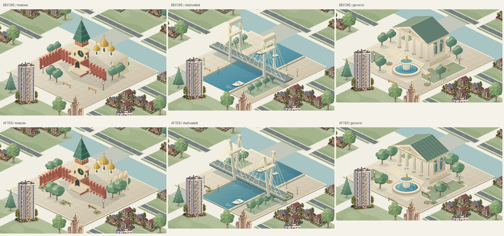

# City-center illustration detail review — 2026-11-08

## Delivered scope

The **three active SVG masters and their real Chromium PNG exports** were refined; this is not a change to the unused procedural landmark helper or a display-size increase.

- **Moscow:** recessed curtain-wall arcades/plinth, staggered masonry courses, tower window surrounds, standing-seam roof, ribbed gilded domes, cathedral roof ridges and sculpted scalloped gables with stone moldings.
- **Vladivostok:** split/inclined cable-stayed pylon legs, construction joints and anchor details, box-girder bracing/expansion joints, shaded bay edges and broken water reflections.
- **Civic square:** copper roof seams, dentilled entablature, carved pediment, ashlar walls, fluted column relief/capitals, segmented fountain basin and splash/ripple detail.
- Shared layered foliage, slatted benches, stone edging and planted flower boxes use the same muted warm palette. No city-name text, branding, scripts, filters or external assets were added.

The source canvas remains `640 × 520`, ground anchor `(320,350)`, scale `0.62`, raster ratio `2`; `scripts/sprite-spec.json` is unchanged. The actual city screenshots show identical center widths (~499 screen pixels at the comparison zoom), unchanged projected ground `(-20,475.2)` and depth `475.2`. The bridge alpha trim is fractionally shorter after the gate-like top beams were removed. No camera, scene, lot, picking, global depth-sorting or backend code changed.

## Verification

Frozen candidate: `git archive 16d27cb` with only the owned center masters/tests overlaid, not the dirty user source tree.

| Gate | Result |
| --- | --- |
| Test-first source contracts | Three expected RED failures for absent authored relief; GREEN after illustration work |
| CI asset command: `node --test tests/scripts/sprite-export-contract.test.mjs tests/scripts/ci-guard.test.mjs` | **7 passed**, including actual 35-sprite Chromium export, safe sources/references/calibration and mutation guards |
| Repeated real Chromium export | All 45 top-level generated asset files byte-identical on re-export |
| Non-target parity | All **32** other active entries, source SVGs and PNGs byte-identical to HEAD/worktree: 20 houses, 4 parking, 8 environment |
| Frontend lint / ngc / all frontend units / production build | Passed; **44 tests**, zero failures |
| Selected read-only Chromium specs | **16 passed**: sprites, parking, ten tiers, map/centers, global depth/native picking, six street layouts |
| Served PNG SHA checks | All **35** PNG HTTP bodies match the candidate manifest |
| Windows host preview HTTP | `5388/sprites/manifest.json` returned **200** |
| Private operator preservation | Raw PostgreSQL unchanged; world version **1964**; all four operator container IDs, images and start times unchanged |

The existing Pixi `@xmldom/xmldom` non-ESM optimization warning remains; there are no new dependencies. Backend mutation/persistence suites were deliberately not run against the operator world.

## Visual evidence and candidate

Full-size fit/zoom/street evidence is retained outside Git in `/mnt/d/My city/.hermes-scratch-center-detail/test-results/center-detail/`. `closeups/` includes the before/after native-city screenshots and center crops for all three cities. These are real API state and real Pixi textures, not fabricated scene responses. Visual inspection covered compact ground fit, nearby lots, relief readability and natural foreground occlusion.

Candidate image: `vsk-ci-center-detail-frontend:1108`

Image ID: `sha256:cabdb7885f9dd4dcc9f15ed3c070d620e9c1ff855a6b6d61413f7efa91b9e617`

Built offline from the cached Node dependency/build stage and nginx runtime, with the complete frozen current frontend copied over; no dependency manifests changed. The temporary preview substituted a GET/HEAD-only API proxy configuration **in its container**, not in the reusable image. Operator frontend/backend/dependencies were not deployed, recreated or restarted. The preview was removed after verification. No push performed.

## Limits

These are stylized compact illustrations, not survey-accurate landmark reconstructions. At whole-city fit the centers are intentionally small, so fine stonework becomes legible on zoom; the source footprints were not inflated to disguise that. The user house art retains its own raster/pixel texture. Unrelated user archive deletions and the parking ZIP were left untouched and excluded from the frozen build and commit.
